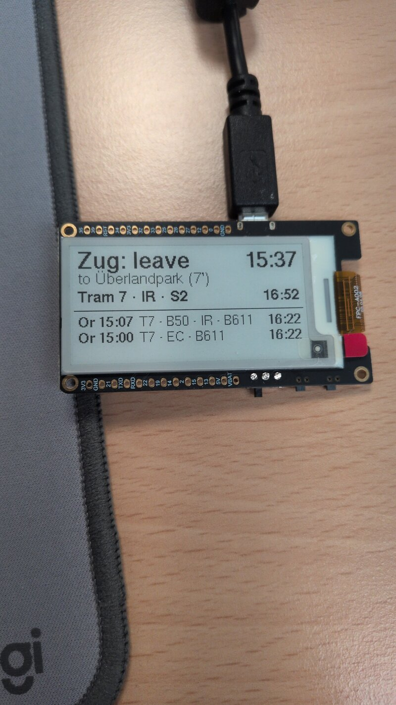

# sbb-commute

A battery-powered e-paper board that answers one question every weekday morning:
**when do I need to leave, and which bus/tram/train do I take?**



## How it works

```
transport.opendata.ch  ──►  Cloudflare Worker (Rust/wasm)  ──►  ESP32 e-paper board (Rust)
   (SBB timetable)            plans the morning, JSON             wakes, syncs, draws, sleeps
```

| Part | What it does |
|---|---|
| [`firmware/`](firmware) | Rust on an ESP32 (LilyGO T5 V2.3, 2.13" SSD1680 e-paper). Each wake-up it loads today's schedule from flash, syncs over Wi-Fi only when needed, redraws only if the screen would change, then deep-sleeps until the first connection shown has gone. The Worker's response also sets the clock, so no NTP. |
| [`worker/`](worker) | Cloudflare Worker in Rust (`workers-rs`). Queries the SBB timetable API and returns the morning's options. Token-protected. |
| [`infra/`](infra) | Deploys the Worker with [Alchemy](https://alchemy.run). Configures the morning window, active days, destination and an optional second "arrive by" trip. |

### Screens

- **Plan**: "Leave HH:MM" big, then stop, walk time, line, delay; two fallbacks below.
- **Trip**: a second destination with an arrive-by time, shown as a chain of legs (`Tram 7 · IR · S2`), latest good departure first (pictured above).
- **Idle**: "Next buses from Mon 06:30" outside the window.
- **Offline**: when the sync fails; retries every 5 minutes.

### Worker endpoints

All requests need `x-token: <TOKEN>` (or `?token=<TOKEN>`).

| Request | Returns |
|---|---|
| `GET /` | Plain-text plan from now (for `curl`) |
| `GET /?format=json` | Same, as JSON |
| `GET /?format=day` | The board's schedule for today's window, current time, and next sync time |

## Setup

1. Copy `.env.example` to `.env` and fill it in.
2. Deploy the Worker:
   ```sh
   cd infra
   bun install
   bun run login     # once
   bun run deploy
   ```
3. Flash the board (needs the [esp-rs](https://github.com/esp-rs/espup) Xtensa toolchain and `espflash`):
   ```sh
   cd firmware
   ./flash.sh        # builds with secrets from ../.env, flashes /dev/ttyACM0, opens the monitor
   ```

On Linux, your user needs access to the serial port (e.g. the `uucp` group on Arch).
